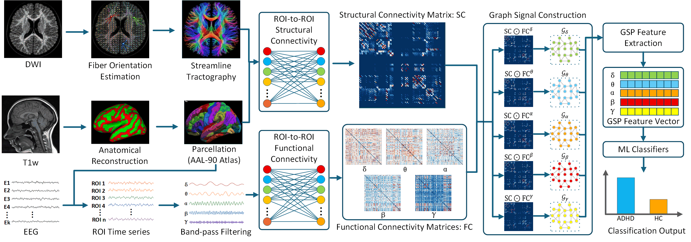
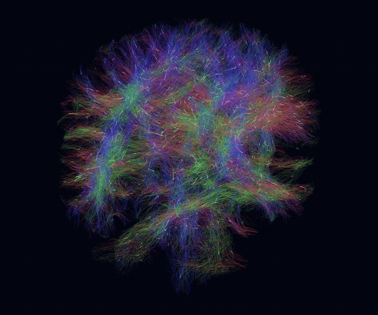
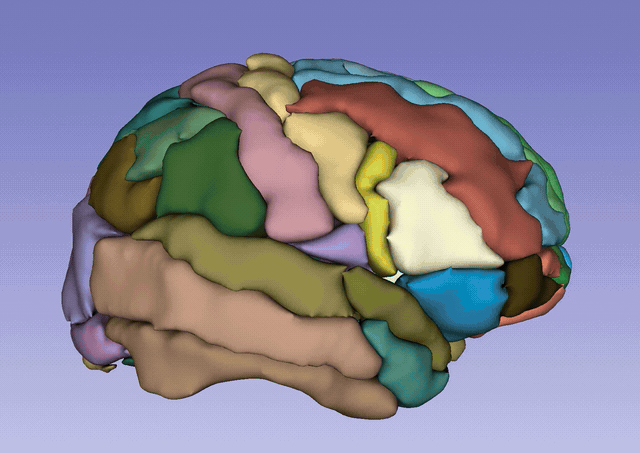

<h1 align="center">Graph Signal Processing of Frequency-Specific Structure-Function Coupling for ADHD Classification</h1>

<p align="center">
  <strong>Haili Ye · Kaidong Wu · Timothy J. Silk · Fei He</strong>
</p>

<p align="center">
  
</p>

FS-SFC-GSP integrates MRI-derived structural connectivity with frequency-specific EEG functional connectivity in a shared anatomical ROI space to construct structure–function coupling networks. Graph spectral entropy features extracted from regional EEG signals on these networks are combined across five frequency bands for ADHD classification using a linear support vector machine.

## 1. Data Preparation

This study uses MRI, EEG, and diagnostic data from the Child Mind Institute's [Healthy Brain Network (HBN)](https://fcon_1000.projects.nitrc.org/indi/cmi_healthy_brain_network/index.html). HBN data and the study's subject ID list are not distributed with this repository. Users must obtain the data independently through HBN and follow its data-use requirements.

### 1.1 Obtain access to HBN data

Follow the official [MRI and EEG access instructions](https://fcon_1000.projects.nitrc.org/indi/cmi_healthy_brain_network/MRI_EEG.html). To obtain the diagnostic and phenotypic information needed for cohort selection, complete HBN's [Data Use Agreement process](https://fcon_1000.projects.nitrc.org/indi/cmi_healthy_brain_network/Phenotypic.html#DUA) and submit an [access application](https://redcap.link/HBN_DUA).

### 1.2 Prepare a private subject file

Select participants with the required T1-weighted MRI, diffusion MRI, and resting-state EEG according to the cohort criteria in the paper. Create a local UTF-8 CSV file at `Data/xxxxx.csv`, with a `subject_id` header and one subject ID per row:

```csv
subject_id
sub-xxxxx
```

`sub-xxxxx` is a placeholder; replace it with your selected HBN subject IDs. IDs with or without the `sub-` prefix are accepted. Keep the completed file private. The downloader only reads the subject ID column; a `label` column is needed later for feature extraction.

### 1.3 Download MRI and EEG

Install DataLad and Git/git-annex for MRI downloads, and `openneuro-py` in your Python environment for EEG downloads. Then run the following command from the repository root:

```bash
python Code/download_hbn_mri_eeg_data.py --subject-csv Data/xxxxx.csv
```

Replace `Data/xxxxx.csv` with the path to your private subject file if needed. The script saves the downloaded data and status records under `Data/`:

- `Data/MRI/`: MRI files for the selected subjects.
- `Data/EEG/`: EEG files for the selected subjects.
- `Data/download_hbn_mri_eeg_data_manifest.csv`: per-subject download status and errors.

Check the manifest for missing data or failed downloads before proceeding to connectivity construction.

## 2. Structural Connectivity Construction

Run the remaining commands from the repository root. Structural processing requires a Linux environment, or WSL when launched from Windows, with MRtrix3, FreeSurfer and a valid FreeSurfer license, FSL, and ANTs. The launching Python environment also needs NumPy and Matplotlib. The default WSL distribution is `Ubuntu-22.04`; use `--distro` to select another installed distribution.

Prepare an AAL90 atlas in MNI152 2 mm space with consecutive ROI labels from 1 to 90, together with a matching TSV containing `index`, `original_value`, and `name`. These files are not included in the repository. Place them at the default locations:

```text
Code/atlases/aal90/aal90_mni152_2mm.nii.gz
Code/atlases/aal90/aal90_mapping.tsv
```

Then build structural connectivity:

```bash
python Code/build_structural_connectivity.py
```

Use `--aal-atlas` and `--aal-mapping` to specify alternative atlas paths. Subjects are selected from successful MRI entries in the download manifest; `--subject sub-xxxxx` selects a specific subject. Add `--preflight` to check inputs and dependencies before processing.

Results are saved to `SFC/<subject_id>/structural_connectivity/`, including SIFT2-weighted connectivity matrices, the atlas in individual MRI space, FreeSurfer intermediate outputs, and QC results. Retain these files for functional connectivity construction.

Animated examples of tractography and MRI segmentation, reconstruction, and AAL90 parcellation are shown below. Click either preview to view the original MP4 video.

<table>
  <tr>
    <th align="center">Tractography</th>
    <th align="center">MRI Reconstruction and AAL90 Parcellation</th>
  </tr>
  <tr>
    <td width="50%" align="center">
      <a href="Figure/TractographyFlow.mp4">
        
      </a>
      <br>
      <a href="Figure/TractographyFlow.mp4">View MP4</a>
    </td>
    <td width="50%" align="center">
      <a href="Figure/SlicerCapture.mp4">
        
      </a>
      <br>
      <a href="Figure/SlicerCapture.mp4">View MP4</a>
    </td>
  </tr>
</table>

## 3. Functional Connectivity Construction

After structural processing, reconstruct EEG signals in each subject's MRI space and obtain time series for the same AAL90 ROIs. The Python environment needs NumPy, pandas, SciPy, Matplotlib, MNE, and NiBabel.

The following command computes both Pearson and wPLI connectivity using 4-second epochs:

```bash
python Code/build_functional_connectivity.py --method pearson wpli --epoch-seconds 4
```

Use `--method pearson` or `--method wpli` to compute only one method; the script defaults to wPLI when this option is omitted. Pearson connectivity retains positive correlations. The first requested method becomes the primary method used by downstream `--fc-method auto` selection.

The script processes subjects with completed structural outputs and available EEG data. It saves all three conditions (`EC`, `EO`, and `ALL`) and five frequency bands (`delta`, `theta`, `alpha`, `beta`, and `gamma`) under:

```text
SFC/<subject_id>/functional_connectivity/<condition>/<band>/
```

Outputs include MRI-space ROI time series, full connectivity matrices, normalised matrices, saved epoch definitions, and QC files. Feature extraction below loads these saved results. Both connectivity scripts accept `--subject sub-xxxxx` to select a subject.

## 4. Feature Extraction

Add diagnostic labels to the private CSV prepared in Section 1, keeping one row per subject:

```csv
subject_id,label
sub-xxxxx1,HC
sub-xxxxx2,ADHD
```

These IDs are placeholders. Labels may be `HC`/`ADHD` or `0`/`1`, where `0 = HC` and `1 = ADHD`. Use the same eligible cohort for all comparisons. Ten-fold stratification requires at least ten subjects in each class, with completed inputs for the selected analysis.

Both extractors use seed `1024` by default and share subject-fold manifests in `SE/_folds/`. The same subjects, labels, and seed reuse the same ten folds. Feature extraction saves features and fold datasets; classification is performed in Section 5. NumPy, pandas, and scikit-learn are required.

### 4.1 Graph spectral entropy features

Extract one graph spectral entropy value per epoch and frequency band. The following example uses SFC graphs, EC data, all five bands, saved Pearson connectivity, and top-5 edge selection:

```bash
python Code/extract_fs_sfc_se_feature.py --labels-file Data/xxxxx.csv --graph SFC --bands ALL --condition EC --fc-method pearson --topk 5 --seed 1024
```

The main settings are:

| Option | Choices and meaning |
| --- | --- |
| `--graph` | `SC`, `FC`, or `SFC`; default: `SFC`. |
| `--bands` | One or more of `delta theta alpha beta gamma`, or `ALL` for a five-dimensional vector per epoch. |
| `--condition` | `EC`, `EO`, or `ALL`; default: `EC`. |
| `--fc-method` | `pearson`, `wpli`, or `auto`, selecting matrices already saved by the FC builder. |
| `--topk` | Number of positive connections selected per node before symmetric union; default: `5`. Set `0` to retain all positive edges. |

Top-k selection applies to all three graph types; the final symmetric degree can exceed k. With `--condition ALL`, EO and EC features are extracted using their respective graphs and then pooled. All epochs from a subject remain in the same fold.

Each run creates a configuration directory under `SE/` containing `features.npz`, `features.csv`, `epochs.csv`, `subject_folds.csv`, and `folds/fold_01/` through `folds/fold_10/`. Each feature row represents one epoch.

### 4.2 Mean SFC features

Extract the subject-level baseline used in Table 2. Each feature is the mean of all 8100 entries of the full 90 × 90 matrix `SC_normalised * FC_normalised`, including zero-valued entries and the diagonal, before graph sparsification.

```bash
python Code/extract_fs_mean_sfc_feature.py --labels-file Data/xxxxx.csv --bands ALL --condition EC --fc-method pearson --seed 1024
```

Each subject contributes one feature row: one scalar for a single band, or five values for `--bands ALL`. This extractor has no top-k parameter. It supports the same band, condition, and saved FC method selections; with `--condition ALL`, it uses the upstream ALL connectivity matrix estimated from pooled EO and EC epochs.

Outputs are saved under `SE/mean_SFC_<configuration>/`, including `features.npz`, `features.csv`, `samples.csv`, `subject_folds.csv`, and the ten fold directories. Full SFC matrices and QC records are also saved for each subject.

## 5. Classification and Evaluation

Use the classifier corresponding to the feature type. Replace each example path below with the complete configuration directory printed by its extractor, containing `features.npz` and `folds/`.

### 5.1 Classify spectral entropy features

```bash
python Code/classify_fs_sfc_se_feature.py "SE/<spectral_configuration>"
```

Predictions and metrics are calculated per epoch, with training and test subjects kept separate.

### 5.2 Classify mean SFC features

```bash
python Code/classify_fs_mean_sfc_feature.py "SE/<mean_sfc_configuration>"
```

Predictions and metrics are calculated per subject, with one sample per subject.

### 5.3 Evaluation outputs

Both classifiers reuse the saved ten folds and use a linear SVM with `C=1` and no class weighting by default. Standardisation is fitted on each training fold and applied to its test fold. The settings can be adjusted with `--C`, `--class-weight`, and `--no-standardize`.

Balanced accuracy (BAcc), AUC, sensitivity (Sens), specificity (Spec), and F1 are calculated for each test fold. AUC uses continuous SVM decision scores. Results are summarised as the unweighted mean and standard deviation across the ten folds, with variance saved separately. Standard deviation and variance use `ddof=1` by default, configurable with `--std-ddof`.

Results are saved under `<feature_directory>/classification/<classifier_configuration>/`:

| File or directory | Contents |
| --- | --- |
| `paper_results.csv` | Mean ± standard deviation (%) for the five metrics. |
| `metrics_summary.csv` | Numeric means, standard deviations, and variances. |
| `fold_metrics.csv` | Metrics for each of the ten test folds. |
| `out_of_fold_predictions.csv` | One held-out prediction per epoch or subject, according to the feature type. |
| `folds/fold_01/` to `folds/fold_10/` | Per-fold predictions, confusion matrices, ROC data, and model parameters. |
